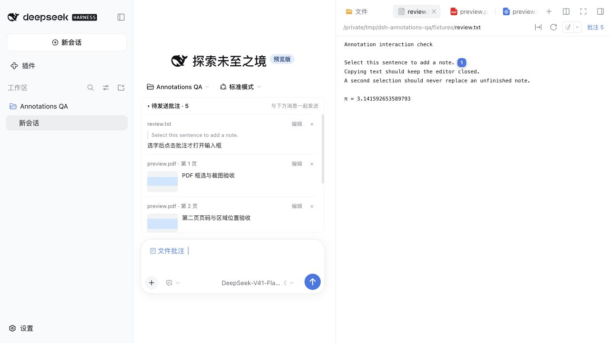

# dsh-file-annotations

批注是**预览期间的临时草稿**。收起右侧边栏、切换标签页或切换会话时会保留。确认关闭文件预览后，清理该文件的 JSON、localStorage、待发送卡片、蓝色引用和图片预览缓存，10 秒内可点「撤销」。撤销期后删除已确认无引用的未发送截图，已发送消息引用的图片继续保留。

在 DSH 文件预览里写批注，在主输入框上方检查本轮批注，然后用原生发送按钮或 Enter 与消息一起发送。

[English](README_EN.md) · 零运行时依赖 · Node 自测



## 使用

1. 打开右侧文件预览。选中文字后点选区旁的「批注」，或在 PDF、图片、HTML 预览中点「框选」并拖出区域。
2. 输入评论并保存。批注自动出现在**主输入框上方的待发送列表**，按当前会话隔离。关闭会清理批注的文件预览前会弹出确认，点「取消」或按 Esc 可继续批注。没有批注时直接关闭。
3. 在列表中检查引用、评论和区域缩略图；可折叠列表、编辑评论、移除批注，或点文件名打开原文件。
4. 在原生输入框补充总要求，再点击 DSH 的发送按钮或按 Enter。只有批注、没有额外文字也可以发送。
5. 宿主确认接收后，本次批注从待发送列表移入历史；提交失败则保留批注，并由 DSH 恢复文字草稿，可修改后重试。

输入框里有一枚简短的「文件批注」引用。发送时，DSH 将它展开为本轮批注的文件路径、引用或区域坐标、评论和裁剪图路径；保存批注不会自动发消息。

可以像删文字一样删除蓝色「文件批注」引用：这会将本批批注移出待发送列表，保留其他消息文字和批注历史，刷新后也不会自动加回。需要恢复时，在文件头部的「批注」历史中点击「加入待发送」。

### 文字批注

TXT、JSON、Markdown、源码等可选文字预览，以及带可选文字层的 PDF 支持文字批注。兼容 Better Sidebar 的 CodeMirror 编辑器，文件内容区的选字可以批注；搜索框等普通输入框仍不弹出批注。

使用 Better Sidebar 打开 HTML 后，可以直接在渲染网页中选字，再点击「批注」或使用选区批注快捷键。文字与代码文件选中后，「批注」与 Better Sidebar 的「添加到对话」显示为同一个选区工具条；后者继续保留原有文件、行号和插入行为。

点击「选元素」再点网页中的段落、标题或图片，可给整个元素加批注；「框选」则保存元素内的局部区域。编号、高亮和选框跟随页面或局部容器滚动，缩放、换行和刷新后按元素重新定位。目标元素被删除或无法匹配时隐藏标记，避免标到其他内容。

HTML 工具条保留批注数量，使用图标选择网页元素；悬停显示提示，开启后为蓝色，鼠标经过元素时显示边框。框选区域收在旁边的小箭头菜单中，已移除「纯文字」切换入口。网页原有沙箱不变，不开启同源访问。不提供 OCR。

- 选字只显示「批注」选项，点击才打开输入条，不抢走阅读或复制时的焦点。
- 支持单字符及键盘选区，忽略表单输入框内的选区。
- 输入条内 Enter 保存、Esc 取消，输入法组字期间不触发。
- macOS 桌面首次加载 0.4.2 时，将打开文件改为 `⌘O`、选区批注改为 `⌘P`；通过 DSH 设置接口保存，之后不重复覆盖手动修改。原设置留有本地备份，冲突/失败不会强行覆盖。
- 网页端保留 `⌘⇧E`（Windows 为 `Ctrl+Shift+E`）；Linux 网页端默认不绑定。按钮显示实际快捷键，可在 DSH 设置中调整或关闭。
- 蓝色保存按钮与取消按钮等大；Enter 提示放在保存按钮的悬停说明里。输入条内 `⌘Enter` / `Ctrl+Enter` 保存当前批注并发送本会话全部待发送批注。
- 输入条打开后，新选区不会替换正在编辑的草稿。
- 跨 DOM 片段和跨行文字按完整引用匹配，保存偏移、上下文和 PDF 页码；高亮与编号显示在实际文字位置，未渲染或找不到引用时暂不显示编号。

### 区域批注

- PDF、图片、HTML 预览头部提供「框选」；拖拽接收层只覆盖内容可见部分，标签栏和退出按钮可操作。
- 松手后出现输入条，保存后在区域上显示框和编号。Esc 或再次点击框选按钮可退出。
- 写评论期间保留选中区域的虚线框，保存后转为正式标记，取消则清理。
- PDF 页码读取预览器的真实页标记；未渲染页不借用相邻页的画布，离屏标记不会盖住标题栏。
- PDF 和图片裁剪为 PNG。HTML 保存元素选择器、引用文字及元素内坐标，不提供裁剪图。
- 旧版 HTML 仅保存视口坐标，无法可靠推断原元素。旧记录保留在历史中；需要跟随元素时请重新选取，新旧记录不会被自动改写。

### 待发送列表和历史

- 默认列出当前会话加入本次消息的未发送批注，与当前打开哪个文件无关。
- 从旧会话文件地址打开预览，新增批注仍归屏幕上的当前会话，保存在当前会话工作区。
- 编辑评论后先保存或取消，再发送消息；提交中的批注不可编辑或移除。
- 发送期间新增的批注属于下一批，不会被上一批的成功确认清掉。
- 移除最后一条批注会移除原生引用，并保留自己输入的文字。
- 文件预览头部的「批注」入口用于**历史查看和整文件批注**，不再承担批量发送。
- 再次点击同一入口可收起历史卡片；待发送列表里的「发送全部批注」与原生发送按钮共用提交流程。
- 「全部会话」仅扩展历史查看范围，不会把其他会话的待发送批注带入当前消息。
- 旧版误归属的未发送记录可在「全部会话」中点击「移到本会话」恢复。

## 存储

```text
<工作区>/.dsh/annotations.json
<工作区>/.dsh/annotations/crops/<批注 id>.png
```

存储格式仍为 version 2，兼容已有记录。`sessionId` 为空的旧记录可从历史的「全部会话」查看。

- 一条记录包含 `id`、`sessionId`、`path`、`rel`、`quote`、`comment`、`createdAt`，以及可选的 `anchor`、`htmlAnchor`、`region`、`crop`、`sentAt`、`detached`（已从本次消息移除）。
- `sentAt` 表示宿主已接收该批消息，**不表示 AI 已处理完成**。
- JSON 与 localStorage 用作临时恢复缓存；关闭时同步清除对应记录，清理写入失败会提示并重试。发送成功的图片在 crops 目录以 .sent 保留标记保护；pending-cleanup.json 仅记录撤销期内待清理的截图，清理完成后移除。
- 工作区根来自 DSH 会话，不用文件父目录猜测。

宿主路由均为 POST：`resolve`、`read`、`write`、`crop`、`crop-preview`，位于 `/api/dsh-file-annotations/` 下。缩略图读取只接受工作区和批注 id，不接受任意文件路径。

## 安装

```sh
dsh plugin --profile desktop add github:DEVbyQIN/dsh-file-annotations
# 或安装已发布到 npm 的版本
dsh plugin --profile desktop add dsh-file-annotations
```

源码版本和已发布版本可能不同；安装后重启 DSH。卸载：

```sh
dsh plugin --profile desktop remove dsh-file-annotations
```

## 开发和验证

```sh
node --test test/verify.mjs
node --test test/host.test.mjs
```

客户端通过 DSH 的 `conversation.input.dock` 显示待发送列表，通过原生 input-trigger reference codec 参与 Send/Enter 序列化；按会话观察公开 `Session.prompt()` 的宿主确认结果。插件卸载时撤销注册、监听和方法包装，并移除自己的引用。

发布前应在真实 DSH 界面验证：仅批注发送、附加文字与 Enter、失败恢复、跨会话隔离、编辑/移除、刷新恢复、缩略图与侧边栏收起状态。

## 边界

- 本插件只覆盖右侧文件预览，没有 diff 或按代码行号的精确锚定。
- 文件内容变化后不会自动迁移或判定旧批注过期。
- 待发送列表需要 DSH 的 `conversation`、`sessions` 和 `inputTriggers` 客户端服务。宿主接口变化需要重新验证兼容性。
- 多个独立浏览器同时修改同一工作区的存储，仍可能互相覆盖；当前没有协同编辑协议。

PDF 默认保持阅读和选字。手动开启框选后，写批注时暂停框选，保存或取消后可继续框选下一处；按 Esc 退出。切换文件或会话会退出框选。

PDF 的虚线矩形图标用于开启/退出框选，开启时变蓝。旁边小箭头 →「打开 PDF 时默认框选」可选择自动或手动开启，设置会记住并应用于当前及以后打开的 PDF；初始为手动。框选模式支持滚轮/触控板滚动，翻页后可继续圈选；滚动打断正在拖动的框时，只取消该框，保留框选模式。
