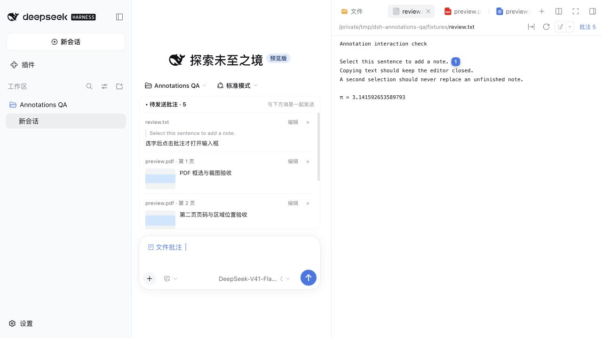

# dsh-file-annotations

Notes are temporary preview drafts. Collapsing the sidebar or switching tabs or conversations preserves them. Confirming a file preview close clears that file’s JSON/localStorage, pending cards, native references and thumbnail caches, with a 10-second Undo. Unsent crops are collected after the grace period. Images referenced by admitted messages remain available.

0.4.2: on first macOS Desktop load, DSH preferences are updated to open files with `⌘O` and annotate selections with `⌘P`. Previous values are backed up, failures roll back, and later manual edits are preserved. Web keeps `⌘⇧E` (`Ctrl+Shift+E` on Windows; Linux Web has no default binding).

TXT, Markdown, source code and selectable PDF text support selection notes. Region notes support PDF, images and HTML; there is no OCR. Support depends on the renderer, not an extension allowlist. Quotes retain occurrence context and PDF page identity, match across DOM spans, and show highlights and badges at the text. The editor placeholder is simply “Write a note”.

While editing a note, `⌘Enter` / `Ctrl+Enter` saves it and sends all pending notes through the native composer. The pending list also offers a Send all notes button. Region outlines stay visible while composing; clicking a sidebar Notes entry again closes its history card. The full-window marker layer no longer suppresses Electron title-bar dragging.

Review files in DSH, check pending notes above the main composer, and send them together with your message using DSH's Send button or Enter.

[中文](README.md) · No runtime dependencies · Node self-tests



## Workflow

Deleting the blue **File notes** reference removes that batch from the message while preserving your typed text and saved notes. The removal survives reload. Use **Add to message** in note history to restore a note.

TXT, JSON and other text files also support annotations in Better Sidebar's CodeMirror editor. For HTML opened through Better Sidebar, select text directly on the rendered webpage and choose **Note**. The **Select webpage element** icon annotates a whole paragraph, heading or image, with a tooltip, blue active state and hover outline. **Box a region** is available from the adjacent arrow menu. The note count stays visible. Marks follow document and nested scrolling, reflow and reload. Missing or changed positional targets are hidden. The separate **Plain text** switch has been removed. The original opaque sandbox is preserved; same-origin access is never enabled. Legacy viewport-only HTML boxes remain in history and need reselecting to acquire an element anchor.

1. Open a file in the right sidebar. Select text and choose **Note**, or choose **Box** and drag a PDF, image, or HTML region.
2. Save the comment. It appears in the **pending list above the main composer**, scoped to the current session. If closing a file preview would clear notes, DSH asks you to confirm. Choose Cancel or press Esc to keep working. Previews without notes close directly.
3. Review the quote, comment, and available region thumbnail. Collapse the list, edit a comment, remove a note, or click its filename to open the source file.
4. Add any general instructions in the native composer, then click Send or press Enter. Notes can also be sent without additional text.
5. Once the Host admits the message, the submitted batch moves to history. A failed admission keeps the notes pending, and DSH restores the message draft for retry.

A compact **File notes** reference appears in the composer. DSH expands it at submission into file paths, quotes or normalized region coordinates, comments, and crop paths. Saving a note never sends a message automatically.

## Selection and regions

- Text and code selections combine **Note** and Better Sidebar’s **Add to conversation** in one toolbar. The native action keeps its file/line context and draft insertion behavior. The note editor opens after an explicit click.
- Single-character and keyboard selections are supported. Form-field selections are ignored.
- In the inline editor, Enter saves and Escape cancels; IME composition is respected. Another selection does not overwrite the open draft.
- PDFs open in ordinary reading/text-selection mode. After enabling Box, saving or cancelling a note returns to box selection for the next region; Escape exits. Capture pauses while editing, and changing file/session exits the mode.
- PDF, image, and HTML box surfaces cover only visible preview content, leaving tabs and toolbar controls clickable.
- PDF page identity comes from the renderer's page markers. An unrendered page never borrows its neighbour's canvas. Offscreen boxes and badges do not float over the toolbar.
- PDF and image crops are saved as PNGs. Sandboxed HTML regions retain coordinates and comments only.

## Pending notes and history

- The list contains all unsent notes for the current session, across files.
- Files opened through older session addresses produce notes for the current on-screen conversation. The pending dock resolves its workspace independently of the file tree.
- Save or cancel an open comment edit before sending. Notes being submitted cannot be edited or removed.
- Notes added during submission remain pending for the next message.
- Removing the last pending note removes the native reference while preserving your own instructions.
- The preview-header Notes entry provides history and whole-file notes; batch submission belongs to the native composer.
- All sessions expands history visibility only; it does not attach another session's pending notes to your message.
- A pending note from another session can be explicitly moved to this chat from history, allowing recovery of earlier ownership mistakes.

## Storage

```text
<workspace>/.dsh/annotations.json
<workspace>/.dsh/annotations/crops/<note-id>.png
```

The version 2 format remains compatible with existing notes. Legacy records without a session id are available in All sessions history.

Records retain `id`, `sessionId`, `path`, `rel`, `quote`, `comment`, `createdAt`, and optional `anchor`, `region`, `crop`, and `sentAt`. **sentAt means Host admission, not completion of the AI's work.**

A localStorage mirror provides browser-local fallback when Host storage is unavailable. Another machine sees only notes successfully persisted to the workspace. Workspace roots are resolved from DSH sessions, never guessed from the parent directory of a file.

The Host exposes POST routes `resolve`, `read`, `write`, `crop`, and `crop-preview` under `/api/dsh-file-annotations/`. Thumbnail reads accept only a workspace and annotation id, not arbitrary filenames.

## Install

### Desktop

In DSH, open **Plugins → Add plugin → Install existing plugin**. Enter `dsh-file-annotations` or `github:DEVbyQIN/dsh-file-annotations`, then install and enable it. Use the in-app plugin manager to uninstall it. [npm package](https://www.npmjs.com/package/dsh-file-annotations)

### Web

```sh
dsh plugin --profile web add dsh-file-annotations@0.6.2
# Or install the same version from GitHub
dsh plugin --profile web add 'github:DEVbyQIN/dsh-file-annotations#v0.6.2'
```

Restart DSH after installation. Use the following command to uninstall.

```sh
dsh plugin --profile web remove dsh-file-annotations
```

## Development

```sh
node --test test/verify.mjs
node --test test/host.test.mjs
```

The client uses `conversation.input.dock` for the list and an input-trigger reference codec for native Send/Enter serialization. A per-session wrapper observes the public `Session.prompt()` admission result. Disposal removes registrations, listeners, wrappers, and the plugin-owned reference.

Verify the real UI before delivery, including notes-only submission, extra instructions and Enter, admission failure recovery, session isolation, editing and removal, reload restoration, thumbnails, sidebar collapse and preview close.

## Limits

- Right-sidebar previews only; no diff review or exact source-line anchoring.
- Old notes do not automatically migrate or become outdated when file content changes.
- Native composer integration requires DSH's `conversation`, `sessions`, and `inputTriggers` client services and must be revalidated after incompatible Host changes.
- Concurrent edits from independent browsers may still overwrite the shared workspace file; there is no collaborative editing protocol.

The PDF dashed-rectangle icon toggles Box mode, with a blue active state. Its adjacent arrow offers **Enable box selection when opening PDFs**, saved in the current browser/desktop profile (manual activation by default). Wheel/trackpad scrolling keeps Box mode active, including after page changes. Scrolling during a drag cancels that box while keeping the tool ready. Escape and manual exit stay respected for the current PDF visit.
